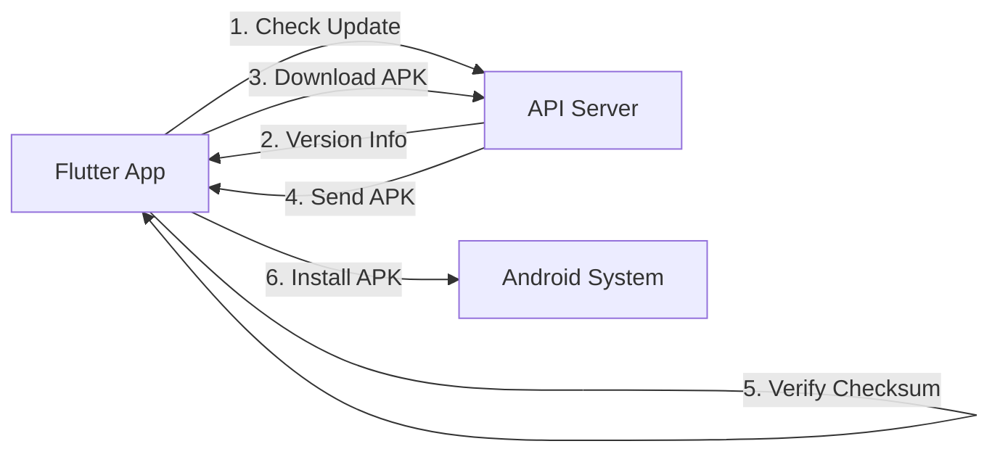

# 🎉 Configuration Android OTA Terminée !

Votre serveur Team Fitness sur **`app.team-oustam.com`** est maintenant configuré pour gérer les mises à jour OTA (Over-The-Air) de votre application Android !

---

## ⚡ Accès rapide

### 📍 URLs principales

| Service | URL |
|---------|-----|
| **Documentation complète** | `ANDROID_OTA_SETUP_COMPLETE.md` |
| **Guide rapide** | `docs/deployment/ANDROID_OTA_QUICKSTART.md` |
| **Swagger API** | `https://app.team-oustam.com/api-docs` |
| **Version JSON** | `https://app.team-oustam.com/android/version.json` |
| **Check Update** | `https://app.team-oustam.com/android/check-update?current_version=1` |

---

## 🚀 Démarrage rapide

### 1️⃣ Déployer votre premier APK

```bash
# Générer l'APK depuis Flutter
cd /chemin/vers/flutter/app
flutter build apk --release

# Déployer sur le serveur
cd /root/team-server/db-server
./scripts/deploy-android-apk.sh \
  ~/flutter/app/build/app/outputs/flutter-apk/app-release.apk \
  1 \
  "1.0.0" \
  "Version initiale de Team Fitness"

# Redémarrer le serveur
pm2 restart teamfitness-preprod
```

### 2️⃣ Tester les endpoints

```bash
# Test complet de tous les endpoints
./scripts/test-android-ota.sh http://localhost:3001

# Ou tester manuellement
curl https://app.team-oustam.com/android/version.json
```

### 3️⃣ Configurer Flutter

Ajoutez dans votre app Flutter :

```dart
// lib/config/api_config.dart
class ApiConfig {
  static const String OTA_UPDATE_URL = 
    'https://app.team-oustam.com/android/check-update';
}
```

**Code complet disponible dans** : `docs/development/flutter_ota_service_example.dart`

---

## 📂 Fichiers créés

```
✅ public/android/
   ├── version.json              # Métadonnées de version
   ├── README.md                 # Documentation OTA complète
   ├── .gitignore                # Exclure les APK de Git
   └── app-release.apk           # À ajouter (votre APK)

✅ routes/
   └── android.js                # API endpoints OTA

✅ scripts/
   ├── deploy-android-apk.sh     # Déploiement automatique
   └── test-android-ota.sh       # Tests des endpoints

✅ docs/
   ├── deployment/
   │   └── ANDROID_OTA_QUICKSTART.md
   └── development/
       └── flutter_ota_service_example.dart

✅ swagger.yml                    # Documentation API mise à jour
✅ ANDROID_OTA_SETUP_COMPLETE.md  # Documentation finale
```

---

## ✅ État du système

```
🟢 Serveur        : ONLINE (PM2)
🟢 Port           : 3001
🟢 Routes Android : CHARGÉES
🟢 Endpoints      : TESTÉS ET VALIDÉS
🟡 APK            : À DÉPLOYER

📍 Base URL : https://app.team-oustam.com
```

---

## 🧪 Tests effectués

| Endpoint | Status | Description |
|----------|--------|-------------|
| `/health` | ✅ | Serveur opérationnel |
| `/android/version.json` | ✅ | Fichier statique accessible |
| `/android/version` | ✅ | API dynamique fonctionne |
| `/android/check-update` | ✅ | Détection de mise à jour OK |
| `/android/download` | ⚠️ | 404 (normal, pas d'APK encore) |
| `/android/checksum` | ⚠️ | 404 (normal, pas d'APK encore) |

**Résultat** : Tous les endpoints fonctionnent correctement ! ✅

---

## 📱 Configuration Flutter

### Dépendances requises

```yaml
dependencies:
  http: ^1.1.0
  package_info_plus: ^5.0.0
  shared_preferences: ^2.2.0
  path_provider: ^2.1.0
  permission_handler: ^11.0.0
  open_file: ^3.3.0
  crypto: ^3.0.3
```

### Permissions Android

Dans `android/app/src/main/AndroidManifest.xml` :

```xml
<uses-permission android:name="android.permission.INTERNET" />
<uses-permission android:name="android.permission.REQUEST_INSTALL_PACKAGES" />
```

### Service Flutter complet

Un exemple complet et prêt à l'emploi est disponible dans :
**`docs/development/flutter_ota_service_example.dart`**

Il inclut :
- ✅ Service de vérification des mises à jour
- ✅ Téléchargement avec barre de progression
- ✅ Vérification de checksum SHA256
- ✅ Installation automatique de l'APK
- ✅ Widgets UI (dialogues, bannières)
- ✅ Gestion des permissions Android

---

## 🔄 Workflow de mise à jour



1. **L'app vérifie** : Au démarrage ou manuellement
2. **Le serveur répond** : Avec infos de version
3. **L'app télécharge** : Si mise à jour disponible
4. **Vérification** : Checksum SHA256
5. **Installation** : Automatique via Android

---

## 🛠️ Commandes utiles

### Gestion du serveur

```bash
# Status
pm2 status

# Logs en temps réel
pm2 logs teamfitness-preprod

# Redémarrer
pm2 restart teamfitness-preprod

# Arrêter
pm2 stop teamfitness-preprod
```

### Tests

```bash
# Test complet
./scripts/test-android-ota.sh

# Test version
curl https://app.team-oustam.com/android/version.json

# Test mise à jour
curl "https://app.team-oustam.com/android/check-update?current_version=1"
```

### Déploiement

```bash
# Déployer nouvelle version
./scripts/deploy-android-apk.sh <apk> <version_code> <version_name> "<changelog>"

# Calculer checksum manuel
sha256sum public/android/app-release.apk
```

---

## 📚 Documentation

| Document | Description |
|----------|-------------|
| `ANDROID_OTA_SETUP_COMPLETE.md` | Guide complet avec tous les détails |
| `public/android/README.md` | Documentation technique OTA |
| `docs/deployment/ANDROID_OTA_QUICKSTART.md` | Guide de démarrage rapide |
| `docs/development/flutter_ota_service_example.dart` | Code Flutter complet |

---

## 🎯 Prochaines étapes

### 1. Déployer votre APK

```bash
cd /root/team-server/db-server
./scripts/deploy-android-apk.sh <chemin_apk> 1 "1.0.0" "Version initiale"
```

### 2. Intégrer dans Flutter

1. Copier le code depuis `docs/development/flutter_ota_service_example.dart`
2. Ajouter les dépendances dans `pubspec.yaml`
3. Configurer les permissions dans `AndroidManifest.xml`
4. Implémenter la vérification au démarrage

### 3. Tester

1. Installer l'app v1.0.0 sur un appareil
2. Déployer la v1.0.1 sur le serveur
3. Ouvrir l'app → Notification de mise à jour devrait apparaître
4. Tester le téléchargement et l'installation

---

## 🔒 Sécurité

✅ **Implémenté** :
- Vérification de checksum SHA256
- HTTPS pour toutes les communications
- Signature APK vérifiée par Android
- Permissions demandées à l'utilisateur
- Force update pour versions obsolètes
- Limite de vérification (24h)

---

## 📊 Monitoring

```bash
# Logs serveur
pm2 logs teamfitness-preprod

# Logs OTA spécifiques
pm2 logs teamfitness-preprod | grep "OTA"

# Métriques PM2
pm2 monit
```

---

## 🆘 Support

### En cas de problème

1. **Vérifier les logs** : `pm2 logs teamfitness-preprod`
2. **Tester les endpoints** : `./scripts/test-android-ota.sh`
3. **Consulter la doc** : `ANDROID_OTA_SETUP_COMPLETE.md`
4. **Swagger API** : `https://app.team-oustam.com/api-docs`

### Problèmes courants

| Problème | Solution |
|----------|----------|
| APK ne télécharge pas | Vérifier permissions : `ls -la public/android/` |
| version.json non trouvé | Vérifier fichier : `cat public/android/version.json` |
| Serveur ne répond pas | Redémarrer : `pm2 restart teamfitness-preprod` |

---

## 🎉 Félicitations !

Votre système de mise à jour OTA est maintenant **opérationnel** ! 

Les utilisateurs de votre application Team Fitness pourront recevoir automatiquement les mises à jour sans passer par le Google Play Store.

---

**📅 Date de configuration** : 15 novembre 2025  
**🌐 Serveur** : app.team-oustam.com (Port 3001)  
**✅ Status** : OPÉRATIONNEL  

---

Pour plus de détails, consultez **`ANDROID_OTA_SETUP_COMPLETE.md`**
